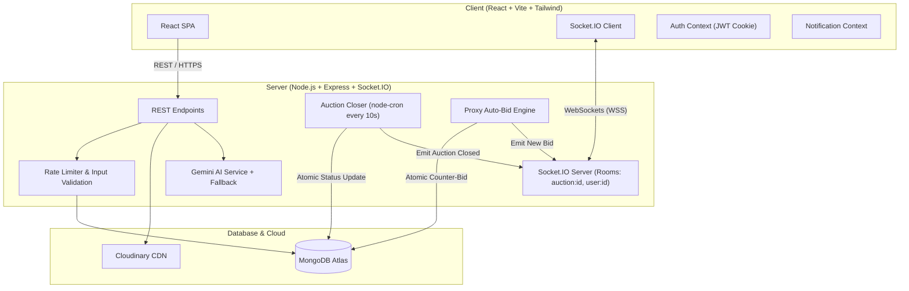

# 🎓 Campus Auction — Student Marketplace

[](#-testing)
[](#-tech-stack)
[](LICENSE)

A complete, real-time student-to-student auction platform designed for college campuses. Graduating students sell used essentials — bicycles, calculators, textbooks, electronics, and dorm furniture — to junior students through competitive, fair, and anti-snipe protected auctions.

---

## 🌟 Key Features

### 🔐 Student Authentication & Account Security
- Secure registration, login, and profile management with **bcrypt** password hashing (12 salt rounds).
- Stateless **JWT stored in httpOnly, Secure cookies** to prevent XSS credential theft.
- Rate limiting on authentication endpoints to defend against credential brute-force attacks.
- Public data anonymization: Student names are sanitized (`Rahul Kumar` $\rightarrow$ `Rahul K.`) on all public bid histories and Q&A logs.

### 🏷️ Auction Listings & Photo Management
- Multi-photo upload (up to 5 photos) with automatic Cloudinary CDN hosting and local base64 fallback.
- Standardized student categories (`Textbooks`, `Electronics`, `Bicycles`, `Calculators`, `Furniture`, `Clothing`, `Sports`, `Stationery`, `Other`).
- Detailed condition ratings (`Like New`, `Good`, `Fair`, `Worn`).
- Starting prices, customizable minimum bid increments, and closing deadlines.
- Sellers can edit or cancel listings provided **no bids have been placed yet**.

### ⚡ Real-Time Bidding Engine & Concurrency Protection
- **Socket.IO** rooms (`auction:${id}`) provide instant, sub-second bid broadcasts across all connected viewers.
- High-concurrency race condition safety implemented with **MongoDB atomic `findOneAndUpdate` operations**.
- Server validates that manual bids meet or exceed `currentPrice + minBidIncrement`.
- Prevents shill bidding: Sellers are strictly blocked from bidding on their own listings.

### ⏱️ Last-Minute Anti-Snipe Extension
- If any valid bid is submitted with **30 seconds or less remaining**, the server automatically extends the closing deadline to **60 seconds from that bid**.
- The updated countdown resets across all connected student devices simultaneously without requiring a page refresh.

### 🤖 Automatic Proxy Bidding Engine
- Students can set a confidential maximum bid limit.
- The system automatically places counter-bids by the minimum increment only when needed to maintain the student's lead.
- First-set priority breaks ties deterministically.
- Hidden maximums are strictly confidential and never exposed via public APIs or Socket broadcasts.

### 🏁 Auction Closing & Campus Handover Workflow
- Background cron job (`node-cron`) automatically evaluates and transitions expired auctions every 10 seconds.
- Auctions with 0 bids are cleanly marked `unsold`.
- Auctions with bids transition to `pending_approval`, allowing the seller to approve or reject the final winning price.
- Approval reserves the item (`sold`) and coordinates a physical campus handover (`completed`) or records failed pickups (`failed_pickup`).

### 💬 Questions & Answers with Spam Protection
- Item-specific public Q&A thread for buyers to clarify condition or campus pickup spot before bidding.
- Rate-limited to 5 questions per hour per student per auction to prevent spam.
- Real-time notification to the seller and instant broadcast when the seller answers.

### 🎯 Saved Searches & Multi-Channel Notifications
- Students can save filter presets (e.g. "scientific calculator under ₹400").
- New listings are automatically matched on publish, delivering in-app alerts and browser notifications.
- Unique deduplication keys prevent duplicate alerts.

### 🧠 AI Campus Assistant
- Natural language query parser: understand requests like *"Find me a bicycle under ₹2,000"*.
- Recommends real items directly from the database matching the criteria.
- Answers questions about auction rules (anti-sniping, auto-bidding, handover).
- **Safety guardrail**: Respects the student's personal spending limit and always requires explicit user confirmation before placing bids.

---

## 🛠 Tech Stack

| Layer | Technology | Purpose |
|-------|-----------|---------|
| **Frontend** | React 18, Vite | Single-page reactive application |
| **Styling** | Tailwind CSS v4 | Responsive mobile-first UI |
| **Icons** | React Icons (Heroicons, Phosphor) | Modern icon set |
| **Backend** | Node.js, Express | REST API & WebSocket server |
| **Real-Time** | Socket.IO | WebSockets with polling fallback |
| **Database** | MongoDB with Mongoose | Atomic operations & text indexing |
| **Cron Engine** | `node-cron` | 10s recurring auction closure job |
| **Security** | Helmet, bcryptjs, jsonwebtoken, express-rate-limit | Defense-in-depth |
| **Image Hosting**| Cloudinary | CDN-backed image optimization |
| **AI** | Google Gemini API | Conversational natural language queries |
| **Testing** | Vitest, Supertest | Fast unit and integration tests |

---

## 🏗 System Architecture



---

## 🚀 Quickstart & Local Setup

### Prerequisites
- Node.js 18+
- MongoDB instance (local or MongoDB Atlas connection string)
- *(Optional)* Cloudinary and Gemini API keys

### 1. Clone the repository
```bash
git clone https://github.com/<your-username>/campus-auction.git
cd campus-auction
```

### 2. Configure Environment Variables
Copy `.env.example` to `.env` in the project root:
```bash
cp .env.example .env
```
Update `.env` with your values:
```env
PORT=5000
MONGODB_URI=mongodb://localhost:27017/campus-auction
JWT_SECRET=your-random-256-bit-secret
CLIENT_URL=http://localhost:5173
```

### 3. Install Dependencies
```bash
# Install server dependencies
cd server && npm install

# Install client dependencies
cd ../client && npm install
```

### 4. Run Development Servers
```bash
# Terminal 1 — Start Backend Server
cd server
npm run dev

# Terminal 2 — Start Frontend Client
cd client
npm run dev
```

Visit **`http://localhost:5173`** in your browser.

---

## 🧪 Testing

Campus Auction includes a comprehensive test suite covering authentication, bid validation, anti-snipe calculations, state transitions, and concurrency protection.

```bash
cd server
npm test
```

### Test Coverage Highlights:
- ✅ Password hashing with `bcryptjs` and token verification
- ✅ Strict category, condition, price, and closing date validation
- ✅ First bid vs. subsequent increment calculation
- ✅ Self-bidding rejection
- ✅ Anti-snipe 30s threshold and 60s extension logic
- ✅ Deterministic auto-bid proxy resolution & first-set tie priority
- ✅ Complete state machine transitions (`active` $\rightarrow$ `pending_approval` $\rightarrow$ `sold` $\rightarrow$ `completed`)
- ✅ Zero-leakage verification of user passwords and hidden max bids

---

## 🎬 10-Minute Demonstration Walkthrough

1. **Register Students**: Create two student accounts — *Rahul (Seller)* and *Priya (Buyer)*.
2. **Create Listing**: As Rahul, list a *"TI-84 Plus Graphing Calculator"* starting at ₹500 with a ₹20 increment, set to close in 2 minutes.
3. **Real-Time Bidding**: Open the auction in two side-by-side browser windows. Place a bid of ₹500 as Priya. Both windows update simultaneously without refresh.
4. **Anti-Snipe Trigger**: When the countdown reaches $\le$ 30 seconds, place a counter-bid as a third student. Observe the countdown timer immediately extend to 60 seconds.
5. **Auction Close & Approval**: Let the timer reach zero. The auction status transitions to `pending_approval`. Rahul clicks **Approve Sale**.
6. **Campus Handover**: Both students confirm physical exchange on campus, transitioning the listing to `completed`.
7. **Ask AI**: Visit `/ai` and ask *"Find me calculators under ₹1000"* or *"How does anti-sniping work?"*.

---

## 📄 License

MIT © 2026 Campus Auction Team
