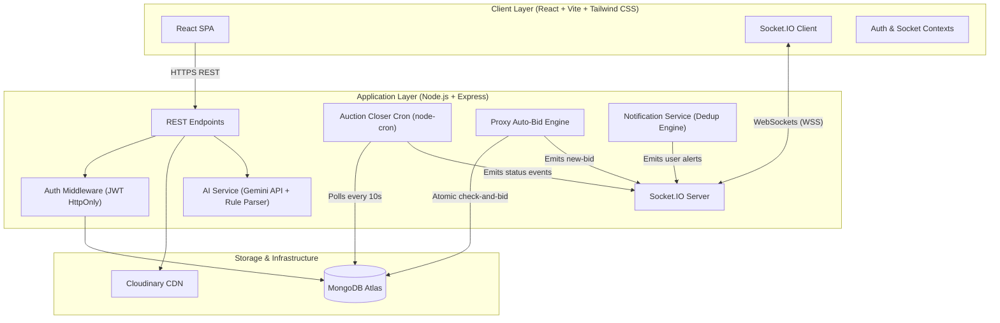

# 🏛️ Campus Auction Architecture Document

Campus Auction is designed around high concurrency safety, real-time synchronization, and strict student account privacy.



---

## 1. Concurrency Control and Race Prevention

Live bidding is inherently susceptible to race conditions when multiple students bid simultaneously. Campus Auction avoids race conditions using **MongoDB Atomic Operations** (`findOneAndUpdate`):

```javascript
const updatedListing = await Listing.findOneAndUpdate(
  {
    _id: listingId,
    status: 'active',
    seller: { $ne: bidderId },
    closingTime: { $gt: now },
    $or: [
      { bidCount: 0, startingPrice: { $lte: amount } },
      {
        bidCount: { $gt: 0 },
        $expr: {
          $lte: [{ $add: ['$currentPrice', '$minBidIncrement'] }, amount]
        }
      }
    ]
  },
  {
    $set: { currentPrice: amount, currentWinner: bidderId },
    $inc: { bidCount: 1 }
  },
  { new: true }
);
```

### Invariants Guaranteed:
1. **Zero Overwriting**: If two students submit bids simultaneously at the same price, exactly one transaction will match the condition and update the document. The second will fail and return `null`, allowing us to gracefully reject with a `409 Conflict` error.
2. **Strict Increments**: A bid cannot jump below `currentPrice + minBidIncrement`.
3. **Self-Bidding Guard**: Sellers can never bid on their own items (`seller: { $ne: bidderId }`).
4. **Deadline Guard**: Bids are unconditionally rejected once server time surpasses `closingTime`.

---

## 2. Anti-Sniping Protection

To ensure fair bidding and stop bot sniping at the last second:

- When a valid bid arrives with **$\le$ 30 seconds remaining** on an active auction:
  $$\text{newClosingTime} = \text{now} + 60\text{ seconds}$$
- The server updates `closingTime` and broadcasts an `auction-extended` event over Socket.IO to the `auction:${id}` room.
- All connected viewers receive the new deadline in real-time without refreshing.

---

## 3. Automatic Proxy Bidding Engine

Students can configure a confidential maximum bid:
- The system only bids the minimum necessary increment to secure the lead.
- In tie situations where two students set the same maximum, priority is awarded deterministically to whichever auto-bid was set earlier (`createdAt: 1`).
- The maximum amount is strictly private (`select: false` or kept in a dedicated protected collection) and never broadcast over Socket.IO or displayed publicly.

---

## 4. Socket.IO Room Architecture

```
socket.io/
├── auction:${listingId}      # Public auction room (new bids, timer extensions, Q&A)
└── user:${userId}            # Private notification room (outbid alerts, won auctions, seller approvals)
```

---

## 5. Security & Privacy Guarantees

1. **Passwords**: Hashed with `bcryptjs` using 12 salt rounds before persisting to MongoDB.
2. **Tokens**: JWT signed with 256-bit secret, stored in httpOnly, Secure, SameSite cookies.
3. **Public Anonymization**: Bid history anonymizes student names (`Rahul Kumar` $\rightarrow$ `Rahul K.`) and never reveals student emails or phone numbers.
4. **Rate Limiting**:
   - Authentication: 20 requests per 15 minutes
   - Bidding: 30 bids per minute
   - Q&A: 5 questions per hour per student per auction
   - AI Chat: 10 requests per minute
